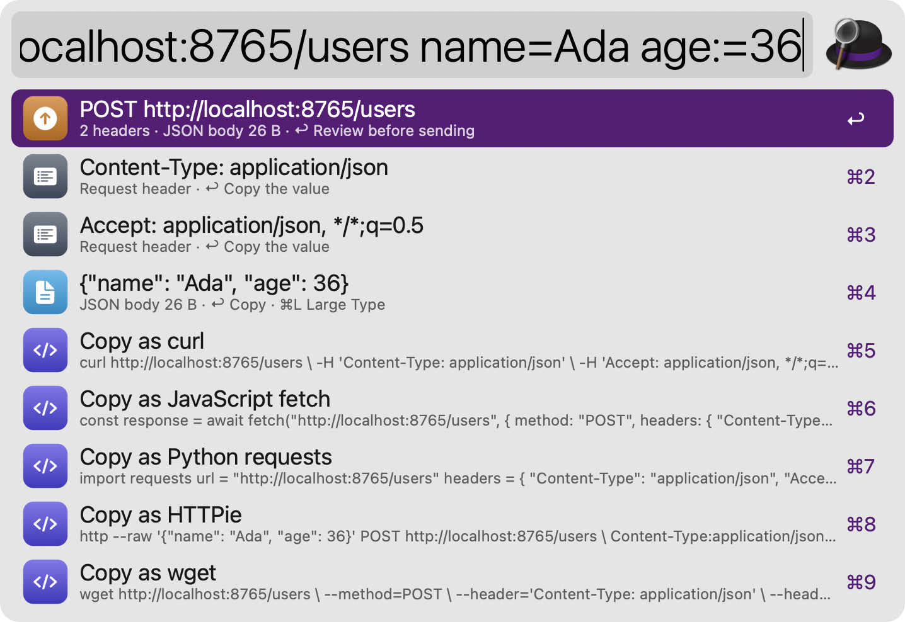
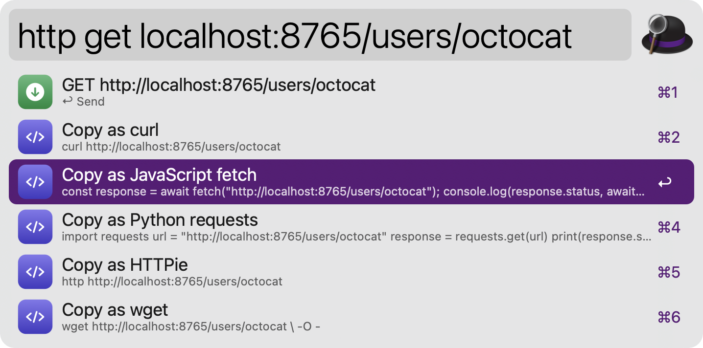
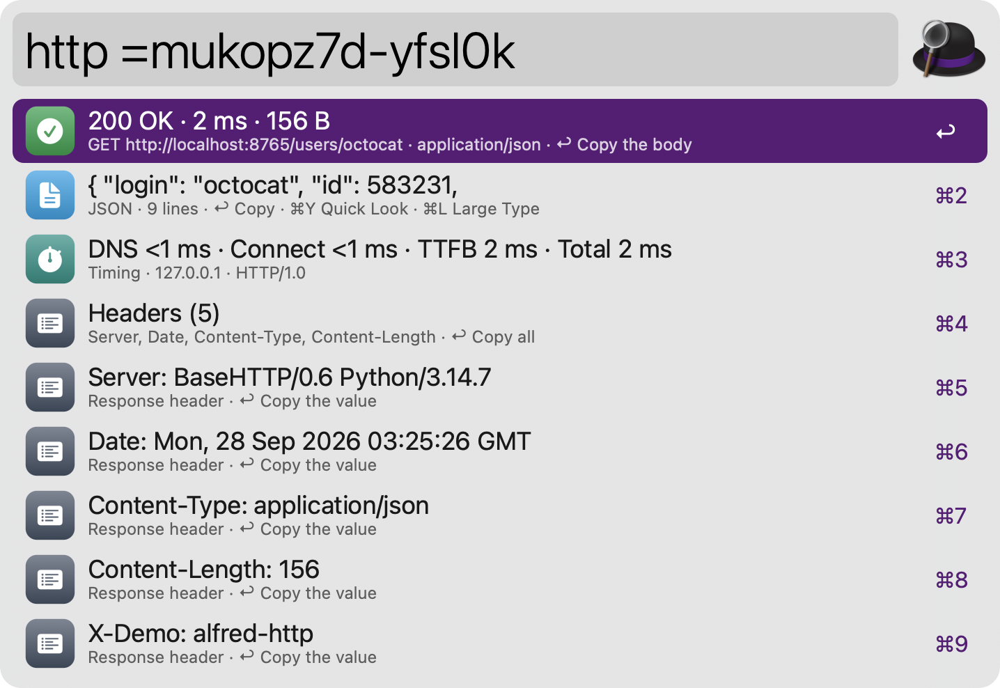
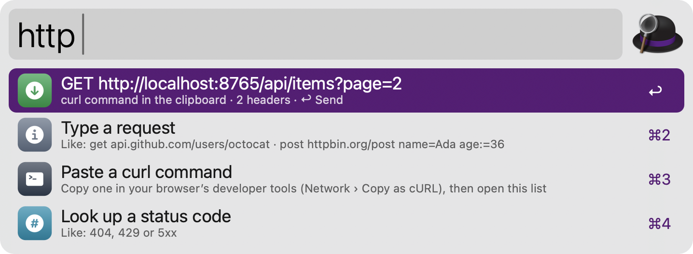
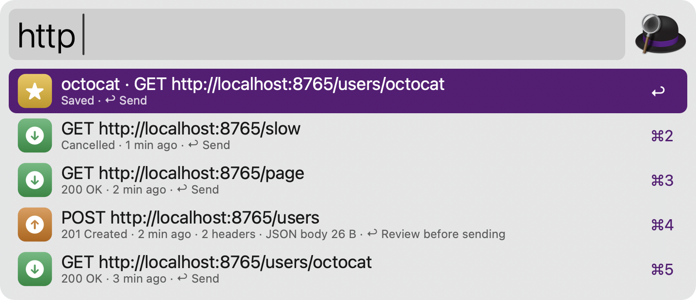
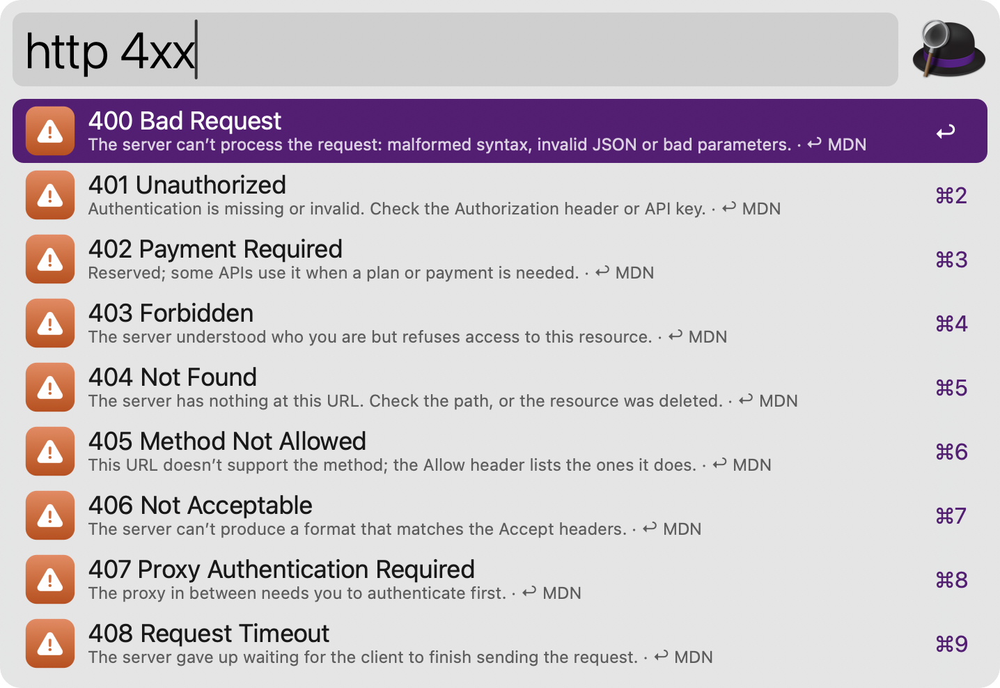

#  HTTP

Send HTTP requests from Alfred, replay curl commands copied from your browser, convert them to code and look up status codes. No dependencies: requests go through the curl that ships with macOS.

## Usage

Type a request via the `http` keyword: a URL, optionally after a method, like `http get api.github.com/users/octocat`. Add headers as `Name:value` or `H:Name=value`, query parameters as `name==value`, JSON fields as `name=value` (text) or `name:=36` (raw JSON), or end with a JSON body, like `http post httpbin.org/post {"name": "Ada"}`. Add `-f` to send the fields as a form, `-u user:password` for basic authentication and `-d` before a raw body. Quote values that contain spaces, or keep typing after a header: `H:Authorization=Bearer abc123`.



* <kbd>↩</kbd> Send the request. POST, PUT, PATCH and DELETE show what will be sent first; press <kbd>↩</kbd> again to send.
* <kbd>⌘</kbd><kbd>↩</kbd> Paste the request as a curl command.
* <kbd>⌥</kbd><kbd>↩</kbd> Open a GET request’s URL in the browser.
* <kbd>⌘</kbd><kbd>L</kbd> Show the request in Large Type, with secrets masked.

The rows below show the headers and body, and copy the request as curl, JavaScript fetch, Python requests, HTTPie or wget.



The response opens in Alfred when it arrives: status, timing (DNS, connect, TLS, time to first byte and total), size, headers and a preview of the body. JSON is pretty-printed, and text in other encodings is decoded.



* <kbd>↩</kbd> Copy the body, open an image or PDF, or show other files in Finder.
* <kbd>⌘</kbd><kbd>↩</kbd> Paste the body into the frontmost app.
* <kbd>⌘</kbd><kbd>Y</kbd> Quick Look the body: JSON, HTML, images and PDFs.
* <kbd>⌘</kbd><kbd>L</kbd> Show the status, headers and body in Large Type.

### curl commands

Copy a request in your browser’s developer tools (Network › Copy as cURL), then use the `http` keyword: the command in the clipboard appears first, ready to send again. Alternatively, paste a command after the keyword, or select one and use the Universal Action. Commands are read without running a shell, and options that would read local files are refused.



### History and saved requests

Recent requests appear via the `http` keyword with nothing typed after it, and typing filters them by URL. Save a request by name via `http save <name>`, then pick a recent request or type one after the name. Authorization headers, cookies, API keys and passwords are masked everywhere they are shown.



* <kbd>↩</kbd> Send the request again.
* <kbd>⌥</kbd><kbd>↩</kbd> Show its last response.
* <kbd>⌃</kbd><kbd>↩</kbd> Remove it from the history or delete the saved request.

Clear the history or the cached responses via `http clear`.

### Status codes

Look up what a status code means via the `http` keyword, like `http 404`, or list a class with `http 4xx`. This works offline and includes common unofficial codes from nginx and Cloudflare.



Set the timeout, the response size limit, whether to follow redirects and whether to ask before sending POST, PUT, PATCH and DELETE in the Workflow’s Configuration.

## Development

```bash
swift tools/make_icons.swift tools/icons.json src   # regenerate icons
python3 tools/build.py --package                     # write src/info.plist and dist/*.alfredworkflow
python3 tests/test_http.py                           # run the tests
```

## AI disclosure

This workflow was developed with the help of Claude (Anthropic), an AI assistant. The code is reviewed and tested by the author.
